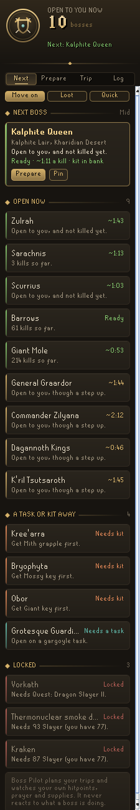
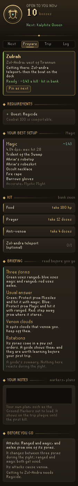
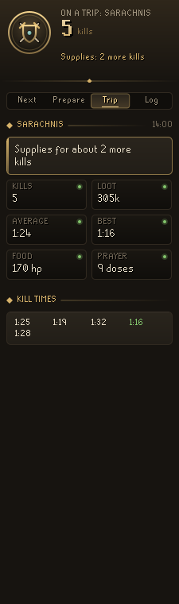
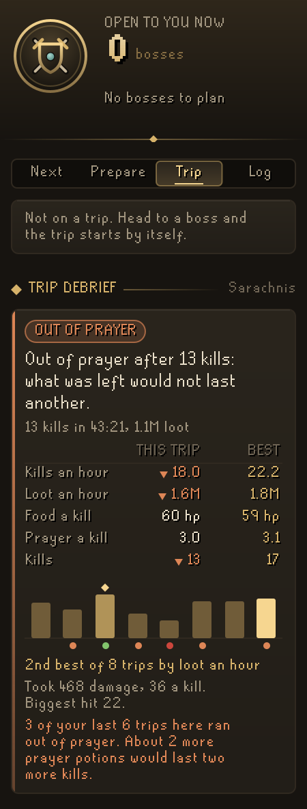
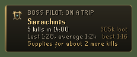
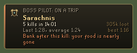
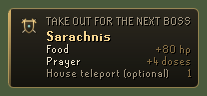
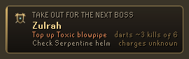
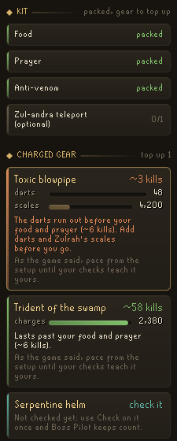

# Codex Boss Pilot

**Plans your bossing around your own account.** Which boss to do next and why, the best setup you own for it, the kit to take out of the bank, and, once you are there, how the trip is going and how long your supplies will last. When you get home, one thing to do differently next time.

It is part of the **Codex** suite, alongside [Codex Gear Roadmap](https://github.com/Nubles/OSRS-Codex-Gear-Roadmap), [Codex Quartermaster](https://github.com/Nubles/OSRS-Codex-Quartermaster), [Codex Autopilot](https://github.com/Nubles/OSRS-Codex-Autopilot) and the rest, and shares their look: warm ink, aged gold and the game's own fonts.

<p align="center">
  
  
  
  
</p>

## What it does

- **The next boss for you.** Every boss is checked against your levels, quests, slayer task, members status and bank, and put in order: the bosses open to you now first, then those a task or a piece of kit away, then the locked ones with exactly what is missing ("Needs 87 Slayer (you have 77)", "Quest: Dragon Slayer II", "Get Mith grapple first"). Pick an aim: **Move on** (new and harder bosses you are ready for), **Loot** (the bosses your own trips have paid best at) or **Quick** (the fastest kills with your gear). **Pin** any boss to keep it at the top.
- **Your best setup, from your bank.** Boss Pilot uses the Codex combat formulas shared with Codex Gear Roadmap to put together the strongest setup you own for each boss, with its kill time, max hit, attack style and offensive prayer. Bosses of several monsters, such as the Dagannoth Kings, get a setup for each.
- **The kit.** Food in hitpoints, prayer in doses, antipoison, antifire and the must-haves such as a key, a spade, a dragonfire shield or a facemask, checked against your bank and your pack. Every dose, charge and colour of an item counts. With the bank open, a plaque lists what to take out; first-visit items such as the ropes at the Kalphite Lair drop off once you have been.
- **Charged gear.** For the toxic blowpipe (darts and scales), the tridents of the seas and swamp and their (e) versions, the sanguinesti staff, Tumeken's shadow, the bow of faerdhinen, the serpentine helm and crystal armour in your setup, how many kills they last: "Toxic blowpipe ~3 kills: the darts run out before your food and prayer (~6 kills). Add darts and Zulrah's scales before you go." Charges come from the game's own Check messages and are carried over each kill; the next check sets them straight and teaches Boss Pilot your own pace at that boss, and it always says how sure it is ("checked 2 kills ago, your own pace here"). At the bank the kit plaque says what to top up; on a trip the plaque says when a charged item will run out before your food, and the debrief says when a trip ended **out of charges**.
- **The briefing.** For every boss, its main mechanics and the usual answer to each, as a guide would sum them up, to read on the Prepare tab before you go. Under it, a box for your own notes, such as the Ground Markers set to load, which the trip plaque repeats until the first kill.
- **On the trip.** A plaque with kills, the trip clock, last, average and best kill time (from the game's own fight durations), loot so far, and how many more kills your food and prayer will last at the rate you are using them, or at your past trips' rate before the first kill. When there is not enough for another kill it says to bank after this one, and can send one notification.
- **Reminders about you.** While at a boss: eat when your hitpoints fall under the share you set, drink when prayer runs low, a combat boost that has worn off, an antifire about to end or not drunk at a dragon, and a must-have item you came without. They look only at you, never at the boss.
- **The trip debrief.** When a trip ends, a seal says why: **died**, **out of food**, **out of prayer**, **bag full**, logged out, hopped, moved on to another boss, or left with supplies for so many more kills. What you carried is read the last time the boss was in sight, so restocking at the bank afterwards is not counted as used. Then the trip set against your best one kept for that boss (kills and loot an hour, food and prayer a kill, deaths, kills, with an arrow for each line that moved and its colour for whether that was for the better), a strip of your recent trips with this one lit, the best crowned and the forced endings marked, and its place ("2nd best of 8 trips by loot an hour"). When most of your recent trips here end the same way, it says so and what to bring: "3 of your last 6 trips here ran out of prayer. About 2 more prayer potions would last two more kills." Damage taken, biggest hit and one piece of advice from your own numbers follow.
- **The log.** Kill counts, best kills, kills and loot an hour for every boss you have fought, kept per account on your computer.

<p align="center">
  
  <br>
  
  <br>
  
  <br>
  
  <br>
  
</p>

## Bosses

Obor, Bryophyta, Scurrius, Giant Mole, Barrows, Sarachnis, Kalphite Queen, King Black Dragon (with Wilderness bosses switched on), Dagannoth Kings, Kraken, Thermonuclear smoke devil, Grotesque Guardians, Zulrah, Vorkath, General Graardor, Commander Zilyana, Kree'arra and K'ril Tsutsaroth. More are a data change.

## Rules posture

Boss Pilot plans trips. During a fight it never reads what a boss is doing: no attack timers or counters, no prayer or tile cues, nothing drawn on a boss or on the ground. Its reminders come only from your own hitpoints, prayer, boosts, antifire and kit, the same kind of thing RuneLite's own low hitpoints and timer plugins show. The briefing and notes on each boss are what a guide says up front, read in the panel before you go. It does not click, type or change menus, reads no files and sends nothing over the network. It reads the game, RuneLite's loot events and, when it has not seen your bank itself, the bank Codex Bank Steward shares. It saves only its own settings, its look at your bank and its logbook of your trips.

## Development

```bash
./gradlew build   # compile and run tests
./gradlew run     # launch RuneLite with the plugin loaded
```

The boss data, kit checks, ranking, trip tracking and the trip debrief (`core/`) are plain Java with unit tests. Replays in `src/test/resources/replays` play whole trips against the plugin, including how a trip ended. The combat formulas (`combat/`, `data/`) are shared with Codex Gear Roadmap. The panel and plaques are in `ui/` and `overlay/`.

## Licence

BSD 2-Clause, see [LICENSE](LICENSE).
