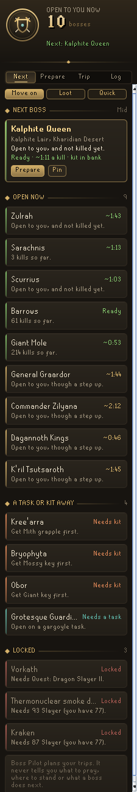
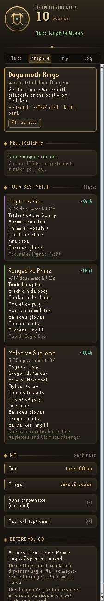
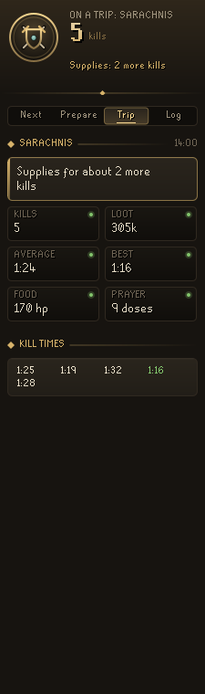
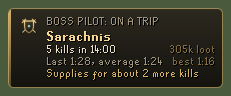
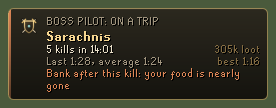
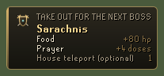

# Codex Boss Pilot

**Plans your bossing around your own account.** Which boss to do next and why, the best setup you own for it, the kit to take out of the bank, and, once you are there, how the trip is going and how long your supplies will last. When you get home, one thing to do differently next time.

It is part of the **Codex** suite, alongside [Codex Gear Roadmap](https://github.com/Nubles/OSRS-Codex-Gear-Roadmap), [Codex Quartermaster](https://github.com/Nubles/OSRS-Codex-Quartermaster), [Codex Autopilot](https://github.com/Nubles/OSRS-Codex-Autopilot) and the rest, and shares their look: warm ink, aged gold and the game's own fonts.

<p align="center">
  
  
  
</p>

## What it does

- **The next boss for you.** Every boss is checked against your levels, quests, slayer task, members status and bank, and put in order: the bosses open to you now first, then those a task or a piece of kit away, then the locked ones with exactly what is missing ("Needs 87 Slayer (you have 77)", "Quest: Dragon Slayer II", "Get Mith grapple first"). Pick an aim: **Move on** (new and harder bosses you are ready for), **Loot** (the bosses your own trips have paid best at) or **Quick** (the fastest kills with your gear). **Pin** any boss to keep it at the top.
- **Your best setup, from your bank.** Boss Pilot uses the Codex combat formulas shared with Codex Gear Roadmap to put together the strongest setup you own for each boss, with its kill time, max hit, attack style and offensive prayer. Bosses of several monsters, such as the Dagannoth Kings, get a setup for each.
- **The kit.** Food in hitpoints, prayer in doses, antipoison, antifire and the must-haves such as a key, a spade, a dragonfire shield or a facemask, checked against your bank and your pack. Every dose, charge and colour of an item counts. With the bank open, a plaque lists what to take out; first-visit items such as the ropes at the Kalphite Lair drop off once you have been.
- **On the trip.** A plaque with kills, the trip clock, last, average and best kill time (from the game's own fight durations), loot so far, and how many more kills your food and prayer will last at the rate you are using them, or at your past trips' rate before the first kill. When there is not enough for another kill it says to bank after this one, and can send one notification.
- **After the trip.** Kills and loot an hour, and one piece of advice from your own numbers: you ran low after five kills and six more sharks would last two more, or you came home with enough for four more kills, so stay longer or bring less.
- **The log.** Kill counts, best kills, kills and loot an hour for every boss you have fought, kept per account on your computer.

<p align="center">
  
  <br>
  
  <br>
  
</p>

## Bosses

Obor, Bryophyta, Scurrius, Giant Mole, Barrows, Sarachnis, Kalphite Queen, King Black Dragon (with Wilderness bosses switched on), Dagannoth Kings, Kraken, Thermonuclear smoke devil, Grotesque Guardians, Zulrah, Vorkath, General Graardor, Commander Zilyana, Kree'arra and K'ril Tsutsaroth. More are a data change.

## Rules posture

Boss Pilot plans trips. It never tells you what to pray, where to stand, when a boss will attack or what it will do next, and it draws nothing on a boss or on the ground. The notes on each boss are the kind of thing a wiki page says up front (the styles it attacks with, what you need to get in). It does not click, type or change menus, reads no files and sends nothing over the network. It reads the game, RuneLite's loot events and, when it has not seen your bank itself, the bank Codex Bank Steward shares. It saves only its own settings, its look at your bank and its logbook of your trips.

## Development

```bash
./gradlew build   # compile and run tests
./gradlew run     # launch RuneLite with the plugin loaded
```

The boss data, kit checks, ranking and trip tracking (`core/`) are plain Java with unit tests. The combat formulas (`combat/`, `data/`) are shared with Codex Gear Roadmap. The panel and plaques are in `ui/` and `overlay/`.

## Licence

BSD 2-Clause, see [LICENSE](LICENSE).
