# Codex Boss Pilot

**Plans your bossing around your own account.** Which boss to do next and why, the best setup you own for it, the kit to take out of the bank, and, once you are there, how the trip is going and how long your supplies will last. When you get home, one thing to do differently next time.

It is part of the **Codex** suite, alongside [Codex Gear Roadmap](https://github.com/Nubles/OSRS-Codex-Gear-Roadmap), [Codex Quartermaster](https://github.com/Nubles/OSRS-Codex-Quartermaster), [Codex Autopilot](https://github.com/Nubles/OSRS-Codex-Autopilot) and the rest, and shares their look: warm ink, aged gold and the game's own fonts.

<p align="center">
  
  
  
  
</p>

## What it does

- **The next boss for you.** Every boss is checked against your levels, quests, slayer task, members status and bank, and put in order: the bosses open to you now first, then those a task or a piece of kit away, then the locked ones with exactly what is missing ("Needs 87 Slayer (you have 77)", "Quest: Dragon Slayer II", "Get Mith grapple first"). Pick an aim: **Move on** (new and harder bosses you are ready for), **Loot** (the bosses your own trips have paid best at) or **Quick** (the fastest kills with your gear). **Pin** any boss to keep it at the top.
- **Your best setup, from your bank.** Boss Pilot uses the Codex combat formulas shared with Codex Gear Roadmap to put together the strongest setup you own for each boss, with its kill time, max hit, attack style and offensive prayer. Bosses of several monsters, such as the Dagannoth Kings, get a setup for each.
- **The kit.** Food in hitpoints, prayer in doses, antipoison, antifire and the must-haves such as a key, a spade, a dragonfire shield or a facemask, checked against your bank and your pack. Every dose, charge and colour of an item counts. With the bank open, a plaque lists what to take out; first-visit items such as the ropes at the Kalphite Lair drop off once you have been.
- **Charged gear.** For the toxic blowpipe (darts and scales), the tridents of the seas and swamp and their (e) versions, the sanguinesti staff, Tumeken's shadow, the bow of faerdhinen, the serpentine helm and crystal armour in your setup, how many kills they last: "Toxic blowpipe ~3 kills: the darts run out before your food and prayer (~6 kills). Add darts and Zulrah's scales before you go." Charges come from the game's own Check messages and are carried over each kill; the next check sets them straight and teaches Boss Pilot your own pace at that boss, and it always says how sure it is ("checked 2 kills ago, your own pace here"). At the bank the kit plaque says what to top up; on a trip the plaque says when a charged item will run out before your food, and the debrief says when a trip ended **out of charges**.
- **The briefing.** For every boss, its main mechanics and the usual answer to each, as a guide would sum them up, to read on the Prepare tab before you go. Under it, a box for your own notes, such as the Ground Markers set to load, which the trip plaque repeats until the first kill.
- **On the trip.** A plaque with kills, the trip clock, last, average and best kill time (from the game's own fight durations), loot so far, and how many more kills your food and prayer will last at the rate you are using them, or at your past trips' rate before the first kill. When there is not enough for another kill it says to bank after this one, and can send one notification.
- **Reminders about you.** While at a boss: eat when your hitpoints fall under the share you set, drink when prayer runs low, a combat boost that has worn off, an antifire about to end or not drunk at a dragon, and a must-have item you came without. They look only at you, never at the boss.
- **The trip debrief.** When a trip ends, a seal says why: **died**, **out of food**, **out of prayer**, **bag full**, logged out, hopped, moved on to another boss, or left with supplies for so many more kills. What you carried is read the last time the boss was in sight, so restocking at the bank afterwards is not counted as used. Then the trip set against your best one kept for that boss (kills and loot an hour, food and prayer a kill, deaths, kills, with an arrow for each line that moved and its colour for whether that was for the better), a strip of your recent trips with this one lit, the best crowned and the forced endings marked, and its place ("2nd best of 8 trips by loot an hour"). When most of your recent trips here end the same way, it says so and what to bring: "3 of your last 6 trips here ran out of prayer. About 2 more prayer potions would last two more kills." Damage taken, biggest hit and one piece of advice from your own numbers follow.
- **Kill efficiency.** After each trip, the kills the game timed itself (its own fight durations, never Boss Pilot's clock) are set against the kill time the best setup from the gear you brought should give, from the same Codex combat formulas: "Kill efficiency 81%. Your 7 timed kills averaged 1:22 against ~1:06 with the best setup from the gear you brought." The Prepare tab draws every trip along your kill count as a learning curve and reads it: still rising (practice is paying off), flat for your last 30 timed kills (a gear upgrade would now do more than practice), or falling. It always says what the figure rests on, and it is shown only between trips.
- **Barrows runs.** A Barrows trip lasts from the mounds through the crypts and tunnels to the chest. The trip plaque and the panel show the brothers killed this run (read from the game), the crypt with the tunnel once you have found it, kept through a relog, and your reward potential on a gauge marked with the reward bands. Pick a potential to aim for (blood runes, bolt racks, the full table and more) and Boss Pilot works out the fewest tunnel kills that bring the run there, counting the brothers you still have to kill, from the wiki's own formula. Every chest goes in your own chest log: what it was worth, loot and chests an hour from runs timed start to chest, and how many chests since your last piece with how often a dry spell that long happens. The set shows the 24 pieces you have seen in your bank, on you or in your chests, and the chance the next chest brings one you are missing. It never highlights monsters, doors or anything in the world.
- **Zalcano.** Zalcano is a Boss Pilot trip from the moment you step into her prison. The Prepare tab checks Song of the Elves and 70 Mining and Smithing, packs a pickaxe, stamina and a teleport crystal, and lists the teleports into Prifddinas you own when Codex Wayfinder is installed. Every kill goes in your own kill log with its loot, worth at the prices of the day. Kills and loot an hour are worked out at your own pace, from kills timed back to back on a trip, so the walk in and breaks do not count. The crystal tool seed, Zalcano shard, Smolcano and uncut onyx each show their wiki drop rate, whether you own one, the kills since your last, and how many players would have had one by then. There are no falling-rock, glowing-rock or damage cues: nothing reacts to the fight.
- **Moons of Peril.** A trip runs while you are by the Lunar Chest or the game's moons panel is up. Every chest goes in your own chest log with its loot, valued at the day's prices, the moons you subdued before it (read from the game between fights) and the food and potion doses the run used, counted a bite and a sip at a time. Chest value an hour and a run, chests an hour and moons a run come from runs timed chest to chest at your own pace. Each moon's set shows the pieces you own (bank, pack or chest), its wiki rate of 1 in 56 a kill, and how many kills of that moon have gone by without a piece against how many players would have had one. Your collection log page for the moons stays in Codex Log Insight. There are no prayer, tile or attack cues: nothing reacts to a fight.
- **The Gauntlet.** The Gauntlet and the Corrupted Gauntlet are a trip from the lobby on. Every run goes in your own run log: its preparation and its Hunllef fight each timed (from the game's own run time line when it gives one, else in game ticks), regular or corrupted, and how it ended: completed with its completion count, died, or left. The best preparation and best fight in each mode make your ghost, and each run shows how far it was off it. While you prepare, the plaque shows the clock against the game's limit and your best; once the fight begins nothing on it moves until the run is over. The enhanced crystal weapon seed, crystal armour seed, crystal weapon seed and Youngllef show their wiki rates in each mode, whether you own one, the completed runs since your last, and how many players would have had one by then. There are no prayer, tornado, tile, attack or damage cues: nothing reacts to the fight.
- **The Maggot King.** A Maggot King trip runs while the boss or its corpse is in sight. Every kill goes in your own kill log: counted once from the game's kill count, how you looted the corpse (Open-stomach or Take-eggs, from the option you picked or the loot itself), what it brought at the day's prices, and the pet's message when it comes, even from an egg popped later at the bank. Kills and loot an hour come from kills timed back to back at your own pace; your recent trips show kills, time, loot, the average kill, food and prayer a kill and deaths. Each of the five collection log drops shows its rate (Jagex's for the elder venator fang, crimson kisten and pet; the wiki's drop-log estimate for the venator fang and tooth), how many loots that could bring it have gone by, the share of players who would have had one by now, and how many were to be expected. Pick a goal and Boss Pilot says how many kills, and how many hours at your pace, give even odds and 9 in 10, counting your own mix of stomachs and eggs. The Prepare tab checks The Blood Moon Rises and your levels against the wiki's two money-making methods and the unlocks on the way. There are no prayer, tile, attack or eat cues and no supplies countdown: nothing on the plaque moves during a fight.
- **The log.** Kill counts, best kills, kills and loot an hour for every boss you have fought, kept per account on your computer.

<p align="center">
  
  <br>
  
  <br>
  
  <br>
  
  <br>
  
  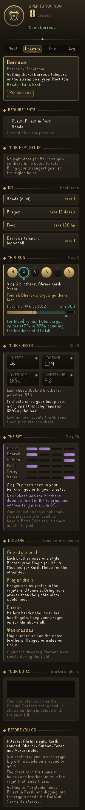
  <br>
  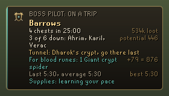
  <br>
  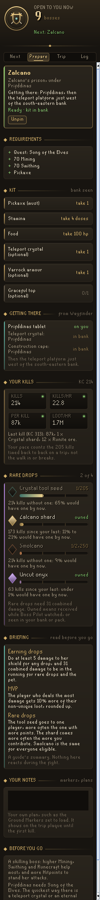
  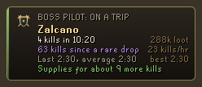
  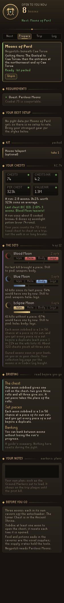
  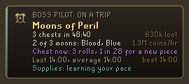
  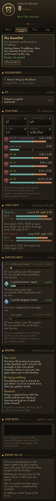
  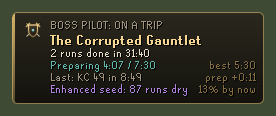
  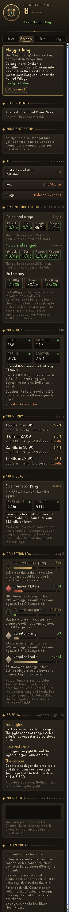
  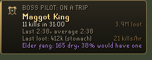
  <br>
  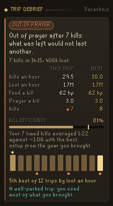
  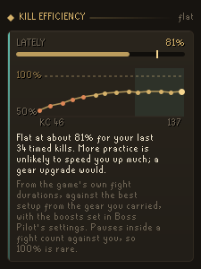
</p>

## Bosses

Obor, Bryophyta, Scurrius, Giant Mole, Barrows, Sarachnis, Kalphite Queen, King Black Dragon (with Wilderness bosses switched on), Dagannoth Kings, Kraken, Thermonuclear smoke devil, Grotesque Guardians, Zulrah, Vorkath, General Graardor, Commander Zilyana, Kree'arra, K'ril Tsutsaroth, Zalcano, the Moons of Peril, the Gauntlet and the Maggot King. More are a data change.

## Rules posture

Boss Pilot plans trips. During a fight it never reads what a boss is doing: no attack timers or counters, no prayer or tile cues, nothing drawn on a boss or on the ground. Its reminders come only from your own hitpoints, prayer, boosts, antifire and kit, the same kind of thing RuneLite's own low hitpoints and timer plugins show. The briefing and notes on each boss are what a guide says up front, read in the panel before you go. It does not click, type or change menus, reads no files and sends nothing over the network. It reads the game, RuneLite's loot events (the Maggot King's loot comes through RuneLite's Loot Tracker), which option you pick on the Maggot King's corpse or a maggot egg, your own loot on the ground at Zalcano and, when it has not seen your bank itself, the bank Codex Bank Steward shares. It saves only its own settings, its look at your bank, its logbook of your trips, your Barrows chests, your Zalcano kills, your Lunar Chests, your Gauntlet runs and your Maggot King kills. It reads the travel atlas Codex Wayfinder shares, if installed, to list your ways into Prifddinas.

## Development

```bash
./gradlew build   # compile and run tests
./gradlew run     # launch RuneLite with the plugin loaded
```

The boss data, kit checks, ranking, trip tracking and the trip debrief (`core/`) are plain Java with unit tests. Replays in `src/test/resources/replays` play whole trips against the plugin, including how a trip ended. The combat formulas (`combat/`, `data/`) are shared with Codex Gear Roadmap. The panel and plaques are in `ui/` and `overlay/`.

## Licence

BSD 2-Clause, see [LICENSE](LICENSE).
